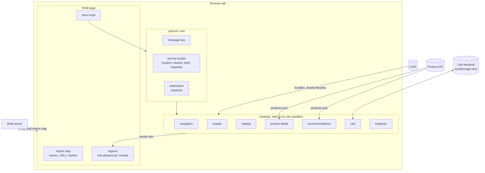
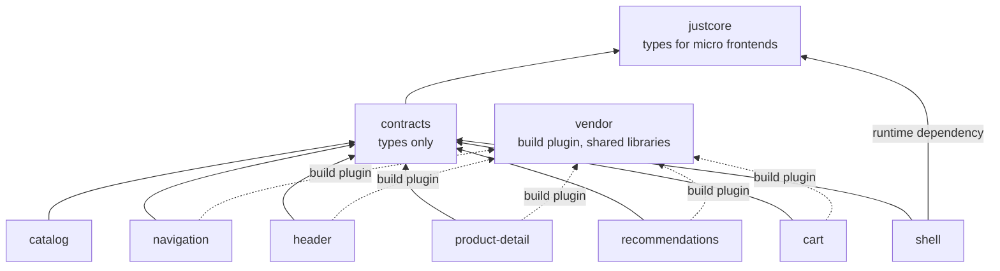

# 1. Architecture

The showcase applies Nicholas Zakas's *Scalable JavaScript Application Architecture* across deployment boundaries. In the talk, modules never touch each other or the application core directly. Each one gets a sandbox and works only through it. Here, each module is also a separate product with its own repository folder, tests, build and release.

## The parts and who owns them

| Part | Framework | Owned by | Deployed as | Internal state |
| --- | --- | --- | --- | --- |
| `mfes/navigation` | React | navigation team | one bundle on the CDN | none |
| `mfes/header` | Vue | header team | one bundle on the CDN | toast list |
| `mfes/catalog` | Astro | catalog team | one bundle with Astro's markup inlined | none |
| `mfes/product-detail` | Svelte | product team | one bundle, plus its product API | product list, chosen quantity |
| `mfes/recommendations` | Angular | recommendations team | one bundle, plus its product API | product list |
| `mfes/cart` | SolidJS | cart team | one bundle, plus its cart backend | cart lines |
| `vendor` | React, Vue, Svelte, Solid, Angular | platform team | shared library files on the CDN, plus the build plugin every team uses | none |
| `shell` | Astro page, plain DOM inspector | platform team | a page, its boot script and its server | the event log |
| `contracts` | types only | shared, reviewed by all teams | not deployed | none |

## What runs where



Locally, `serve.mjs` plays four roles. Port 4400 is the CDN and the product API. Port 4329 is the shell server. Port 4330 is the deployment console, where anyone can pick the build each micro frontend runs. The cart backend is the browser's localStorage, behind a small async interface so it could be an HTTP API.

## What depends on what at build time

Nothing in a micro frontend imports another micro frontend or the shell. Two packages are shared. `contracts` contains types alone, so it adds nothing to any bundle. `vendor` provides a build plugin, which keeps framework packages out of each bundle and points their imports at the shared library files.



Micro frontends never bundle justcore. The core creates their sandbox and passes it to their factory, so they only need its types. The shell is the one part that ships the justcore runtime.

## Four rules that keep the parts independent

1. **Micro frontends share types and pinned third-party libraries, never team code.** A helper such as `formatPrice` or `adoptStyles` is copied into each micro frontend that needs it. Shared team code would force teams to release together. A framework is shared at the exact version each bundle was built with, so it doesn't, as chapter 10 shows.
2. **The shell owns the page and the URL.** It decides where each module renders and is the only code that writes browser history.
3. **State is read through services, and changes are asked for with messages.** A module reads shared state from read-only stores and asks another module to change its internal state with a request message. Chapters 4 and 5 cover this split.
4. **Everything a module creates is tied to its sandbox's signal.** The core aborts the signal when the module stops, so listeners, styles, timers and subscriptions go away with it. That is what makes stopping, restarting and swapping a module safe.

## Mapping to Zakas's architecture

| Zakas | Here |
| --- | --- |
| Application core | The justcore `Core`, created by the shell's boot script. |
| Sandbox | The justcore `Sandbox` each module receives. It offers `getService`, `publishAsync`, `signal` and `moduleId`. |
| Module | A micro frontend's default export, a factory that returns `init` and `destroy`. |
| Base library | Each micro frontend's own framework, at the version it was built with, loaded from the shared vendor build. |
| Extensions | justcore extensions: the shell's inspector. The core itself subscribes modules to the messages they list. |

## Repository layout

```text
examples/showcase/
├── contracts/          types-only contract: services, shared values, messages
├── mfes/
│   ├── cart/           SolidJS, owns the cart and the cart.summary value
│   ├── catalog/        Astro markup plus a small enhancement script
│   ├── header/         Vue, search box, cart badge, toasts
│   ├── navigation/     React, category links
│   ├── product-detail/ Svelte, product page, sends cart.add
│   └── recommendations/ Angular, related products, sends cart.add
├── vendor/             shared framework libraries and the build plugin that uses them
├── shell/              Astro page, boot script, shared state services, inspector
├── api/                the mock product API
├── scripts/            deployments.mjs and publish.mjs: the stand-in deployment service
├── serve.mjs           the stand-in CDN and shell server
├── cdn/                build output, served as the CDN (generated)
└── deployments/        the live import map (generated)
```
