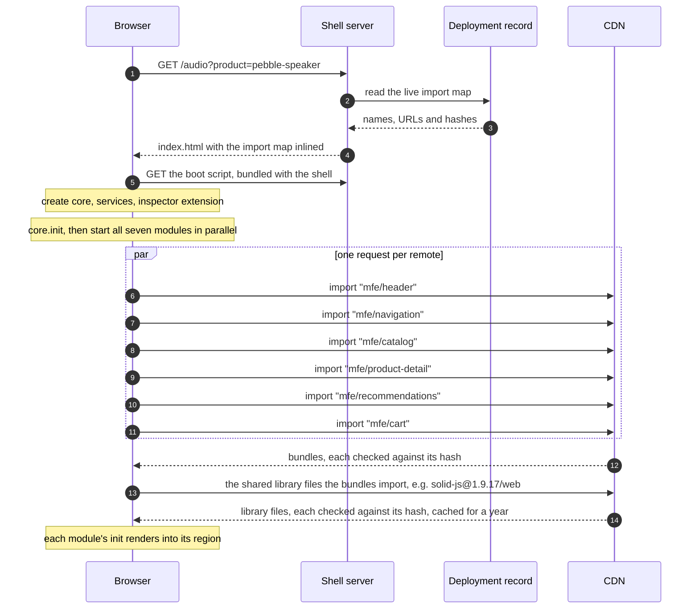
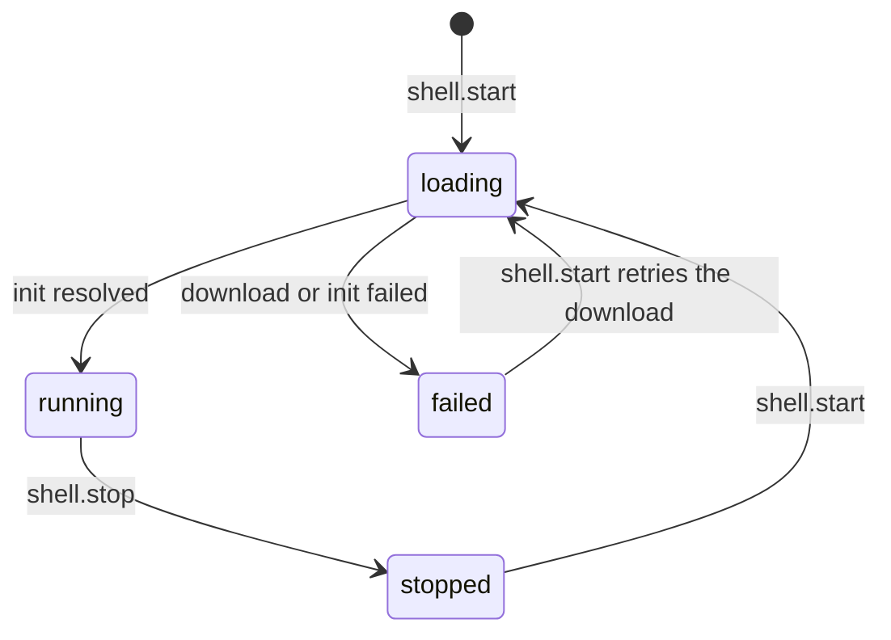

# 2. The shell

The shell is the only part of the page that is not a micro frontend. It owns four things:

- **The layout.** It decides which element each module renders into.
- **The import map.** It says which version of each micro frontend this page loads.
- **The core.** It creates the justcore core and registers the services.
- **The URL.** It is the only code that writes browser history.

It contains no product features. The one module it ships itself is the inspector, a development aid.

## From request to running modules



### Step 1: the server renders the import map

The shell is built once into static files, and the build knows nothing about micro frontend versions. The page template contains a placeholder:

```astro
<!-- shell/src/pages/index.astro -->
<script type="importmap" is:inline set:html="__IMPORT_MAP__" />
```

On every request the shell server reads the deployment record and puts it in place of the placeholder. Locally that is `serve.mjs` reading `deployments/importmap.json`:

```json
{
  "imports": {
    "mfe/cart": "http://localhost:4400/cart/1.0.0/cart-DqFGBwNj.js",
    "mfe/header": "http://localhost:4400/header/1.0.0/header-CpHYjNaX.js",
    "solid-js@1.9.17/web": "http://localhost:4400/vendor/solid-js@1.9.17/web-RYK6nA_w.js",
    "vue@3.5.43": "http://localhost:4400/vendor/vue@3.5.43-p9reLLlJ.js"
  },
  "integrity": {
    "http://localhost:4400/cart/1.0.0/cart-DqFGBwNj.js": "sha384-wAFfmFaq…",
    "http://localhost:4400/header/1.0.0/header-CpHYjNaX.js": "sha384-IYCRzwTz…",
    "…": "one hash for every bundle and every shared library file"
  }
}
```

Besides the `mfe/` names, the map lists the shared framework libraries the published bundles import, each name with its version. Chapter 10 explains them.

That is why deploying a micro frontend never rebuilds the shell: the next page load simply gets a different map. The server escapes `<` in the JSON so the map can never close its own script element.

The import map must appear before any module script, so it comes right after the meta tags in the page head.

### Step 2: the page lays out one region per module

```astro
<header class="region region--header" {...region("header")}></header>
<nav class="region region--nav" aria-label="Categories" {...region("navigation")}></nav>
<main class="region region--catalog" {...region("catalog")}></main>
```

Each region carries `data-module`, `data-framework`, `data-source` and `data-state`. The shell passes the element to the module as `props.root`, and CSS uses the attributes to draw the labels and the loading, stopped and failed states.

### Step 3: the boot script builds the core

`shell/src/app/main.ts` runs once per page:

```ts
const importMap: ImportMap = JSON.parse(document.querySelector("script[type=importmap]")?.textContent ?? "{}");

const core = new Core();
const recorder = createInspector();
core.use([recorder.extension]);

const shell = createShell(core, {
    importMap,
    importModule: specifier => import(/* @vite-ignore */ specifier),
    local: { inspector: inspector as jc.ModuleFactory },
    autoUpdate: true,
    log: label => recorder.record("lifecycle", label)
});

core.serviceLocator.addService("location", () => createLocation());
core.serviceLocator.addService("shared", () => createSharedState());
core.serviceLocator.addService("inspector", () => recorder.service);
core.serviceLocator.addService("shell", () => shell);

core.init(() => {
    for (const { id } of moduleInfo) {
        void shell.start(id);
    }
    setInterval(() => void shell.checkForUpdates().catch(() => undefined), UPDATE_CHECK_MS);
});
```

`importModule` lives in the boot script on purpose. The browser resolves a name such as `mfe/cart` through the import map of the page that calls `import()`, and the boot script is part of that page.

`createShell` registers every module with the core. For a remote, the registered factory is built with justcore's `remoteModule`, which downloads the code when the module first starts. Chapter 3 explains it.

### Step 4: the services modules can reach

| Service | Created by | Used by | Purpose |
| --- | --- | --- | --- |
| `location` | `createLocation` | every remote | The URL as read-only stores, plus `navigate` and `setQuery`. |
| `shared` | `createSharedState` | cart, header | Values with exactly one owning module. |
| `shell` | `createShell` | inspector only | Start, stop and update modules. |
| `inspector` | `createInspector` | inspector only | The recorded event log and running modules. |

Remotes only know the first two, because only those are in `contracts`. The shell adds the other two to the service map in its own `types.ts`, so a remote cannot even name them.

### Step 5: every module starts in parallel

`shell.start(id)` sets the region to `loading`, calls `core.startModule` with the region as `props.root`, and sets `running` or `failed` when the start settles. One slow or broken remote never holds up the others.



## The inspector: an extension plus a local module

The inspector shows what the core does without any module cooperating. It has two halves:

- **An extension** plugs into core hooks. It records every published message through `onMessagePublish`. Through `onModuleStart` and `onModuleStop` it records each start, including how long a remote took to download and initialize, and each stop.
- **A module**, written with plain DOM calls and bundled with the shell, renders that record. It also lists each module's release version and file, and the shared libraries with their sizes and whether they came from the cache. It offers start and stop buttons, an update button, and the switch for automatic updates, through the `shell` service.

This split is the usual justcore pattern. Extensions see the core, and modules see only their sandbox.

## What the shell does not do

- **No client-side routing of modules.** All regions are always present, and each module decides what to show from the URL. A larger app would start and stop modules per route with the same `shell.start` and `shell.stop`.
- **No UI framework.** The inspector is a few dozen lines of DOM code, so the shell ships no framework of its own and never competes with a remote's version. The remotes import theirs from the shared vendor build on the CDN, as chapter 10 explains.
- **No knowledge of product features.** It never handles `cart.add` or reads the cart summary.
