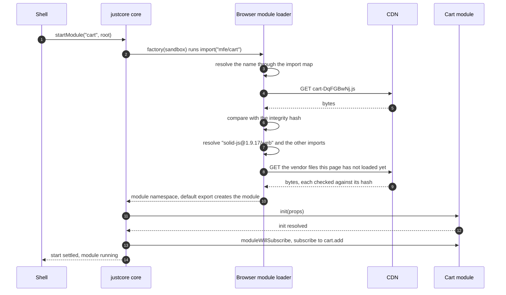
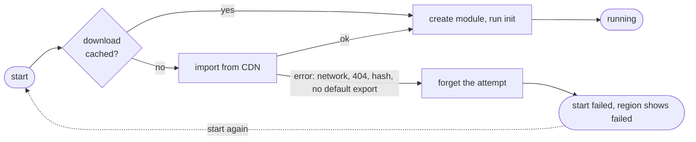

# 3. Loading remote micro frontends

A micro frontend reaches the browser as one small JavaScript file on a CDN, plus the shared framework libraries it imports. This chapter covers what that file must contain, how the browser finds and verifies it, and how justcore turns it into a running module. Chapter 10 covers the shared libraries.

## The contract of a deployable bundle

A bundle is a native ES module whose default export is a justcore module factory:

```tsx
// mfes/navigation/src/index.tsx
const navigation: ShowcaseModuleFactory = sandbox => {
    let root: Root | undefined;
    return {
        sandbox,
        init(props) {
            adoptStyles(css, sandbox.signal);
            root = createRoot(requireRoot(props));
            root.render(<Navigation location={sandbox.getService("location")} />);
        },
        destroy() {
            root?.unmount();
            root = undefined;
        }
    };
};

export default navigation;
```

The rules for that file:

| Rule | Why |
| --- | --- |
| The framework is not bundled. It is imported by a versioned name, such as `solid-js@1.9.17/web`, which the import map points at the shared vendor build. | A deploy downloads only the team's own code. Teams still upgrade on their own schedule, because every version has its own name. |
| CSS is inlined and added through `adoptStyles`, tied to the signal. | One file per deploy, and styles leave with the module. |
| justcore is not imported at runtime. | The sandbox is injected, so a bundle never carries a second core. |
| The file name contains a content hash. | A URL always means the same bytes, so it can be cached forever and verified. |
| No side effects at import time. | Work happens in `init`, where the signal exists. Chapter 8 explains why this matters for swapping. |

## How a bundle is built

Every micro frontend uses Vite in library mode. The cart's config is typical:

```ts
// mfes/cart/vite.config.ts
export default defineConfig({
    plugins: [sharedLibraries(), solid()],
    define: { "process.env.NODE_ENV": JSON.stringify("production") },
    build: {
        outDir: "../../cdn/cart",
        emptyOutDir: false,
        manifest: true,
        lib: { entry: "src/index.tsx", formats: ["es"] },
        rolldownOptions: { output: { entryFileNames: `${pkg.version}/cart-[hash].js`, minify: true } }
    }
});
```

- **`sharedLibraries()`**, from the platform team's `@showcase/vendor` package, leaves framework packages out of the bundle and rewrites their imports to versioned names. Chapter 10 explains it.
- **`${pkg.version}/` in the file name** puts each release in its own folder, such as `cdn/cart/1.0.0/cart-DqFGBwNj.js`. The version comes from the micro frontend's `package.json`. The hash still changes with every build, while the folder tells people which release a URL holds: the region labels, the inspector and the deployment console all read it from there.
- **`emptyOutDir: false`** keeps earlier versions on the CDN. A page that is already open may still need them.
- **`manifest: true`** writes `.vite/manifest.json`, which tells the publish step which file is the entry.
- **The `define`** replaces `process.env.NODE_ENV`, because library builds leave it in place and browsers have no `process`.

The recommendations bundle is Angular compiled ahead of time by `@analogjs/vite-plugin-angular`, so it ships no template compiler and needs no zone.js. The catalog is the one two-step build. Astro first renders the product grid to `dist/fragment.html`. Vite then inlines that markup into the bundle with a `?raw` import. Markup and code therefore share one hash and can never be deployed out of step.

Without its framework, each bundle is a few kilobytes. That is all a returning visitor downloads after a team deploys:

| Bundle | Gzipped now | Gzipped with the framework bundled in |
| --- | --- | --- |
| navigation, React | 1.3 KB | 69 KB |
| recommendations, Angular | 2.0 KB | 39 KB |
| header, Vue | 2.3 KB | 23 KB |
| product-detail, Svelte | 2.0 KB | 14 KB |
| cart, SolidJS | 3.2 KB | 9 KB |
| catalog, Astro | 1.5 KB | 2 KB |
| shell boot script, justcore and the inspector | 7.4 KB | 7.4 KB |

The shared libraries cost more on the very first visit, because a shared copy keeps every export instead of only the ones one bundle uses. Chapter 10 has those numbers and the trade-off. The shell uses no UI framework: its inspector is written with plain DOM calls.

## How the browser finds and verifies a bundle

The import map does two jobs:

```json
{
  "imports": {
    "mfe/cart": "http://localhost:4400/cart/1.0.0/cart-DqFGBwNj.js",
    "solid-js@1.9.17/web": "http://localhost:4400/vendor/solid-js@1.9.17/web-RYK6nA_w.js"
  },
  "integrity": {
    "http://localhost:4400/cart/1.0.0/cart-DqFGBwNj.js": "sha384-wAFfmFaq…",
    "http://localhost:4400/vendor/solid-js@1.9.17/web-RYK6nA_w.js": "sha384-0w1x…",
    "http://localhost:4400/vendor/chunks/solid-jcsmHATi.js": "sha384-Hk3n…"
  }
}
```

- **`imports`** maps a stable name to the current URL. The shell only ever says `import("mfe/cart")`, and the cart bundle only says `import … from "solid-js@1.9.17/web"`.
- **`integrity`** maps a URL to the hash its bytes must have. The browser refuses to run a file that does not match, so a tampered or corrupted CDN object fails the start instead of running. It covers every file the page may load, including the chunks a library imports by relative URL.

The publish step computes the hash from the exact bytes on the CDN, as chapter 7 shows.

The CDN serves bundles from a different origin than the page, so it must send CORS headers. The local CDN sends these:

| File | Cache-Control | Why |
| --- | --- | --- |
| `cart-DqFGBwNj.js`, the vendor files and other hashed files | `public, max-age=31536000, immutable` | The URL changes whenever the content does. |
| Everything else on the CDN | `no-cache` | It may change in place. |
| The shell's HTML and `/importmap.json` | `no-cache` and `no-store` | They carry the live deployment record. |

Every CDN response also carries `Access-Control-Allow-Origin`, and `Timing-Allow-Origin` so that the inspector can read download sizes and tell cache hits from network loads.

## How `remoteModule` turns a URL into a module

`core.addModule` needs a factory right away, but the code is not downloaded yet. A justcore factory may return a promise, and `remoteModule(load)` returns one that downloads the real factory on first start, then creates the module with it:

```ts
const remote = (specifier: string) => remoteModule(() => importModule(specifier));
core.addModule("cart", remote("mfe/cart"));
```



Details that matter in production:

- **The download is cached per factory.** Starting the cart a second time does not fetch it again.
- **A failed download is not cached.** Network errors, 404s, hash mismatches and a missing default export all fail that start: the core aborts the signal and `startModule` rejects with the error. The next start tries again.
- **The core sees the real module.** No stand-in sits in between, so `moduleWillSubscribe`, `moduleDidReceiveProps` and every extension hook run on the cart module itself.
- **justcore contains no `import()`.** The loader is a function the shell passes in, so the library works with any bundler, loader or URL scheme.



## What this deliberately leaves out

- **Module Federation.** It puts a runtime in every bundle that negotiates shared versions in the browser. Here the import map does the sharing, and each bundle's versions are fixed at build time, as chapter 10 explains.
- **JavaScript isolation.** Bundles run in the page's realm. Isolation through iframes or shadow realms would also isolate the shared stores and the message bus, which is the opposite of what this architecture wants.
- **Server rendering of remotes.** Every remote renders in the browser. Astro renders the catalog's markup at build time, not per request.
