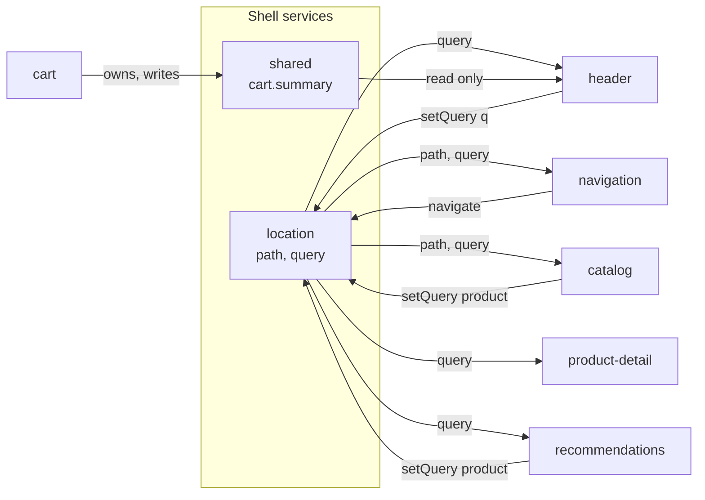
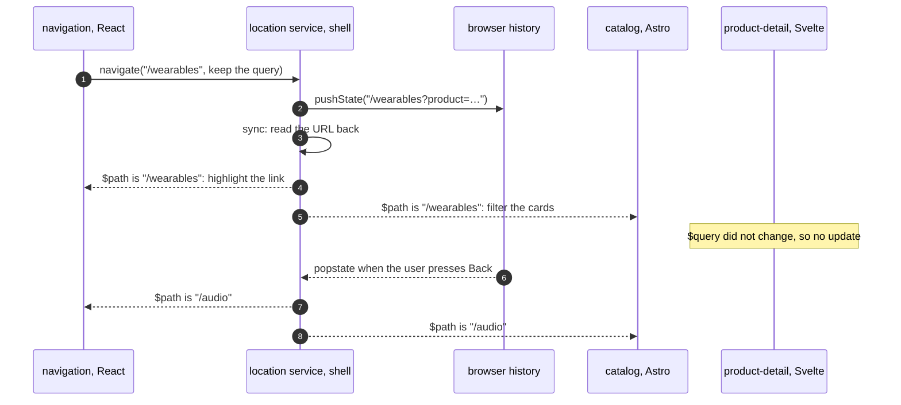
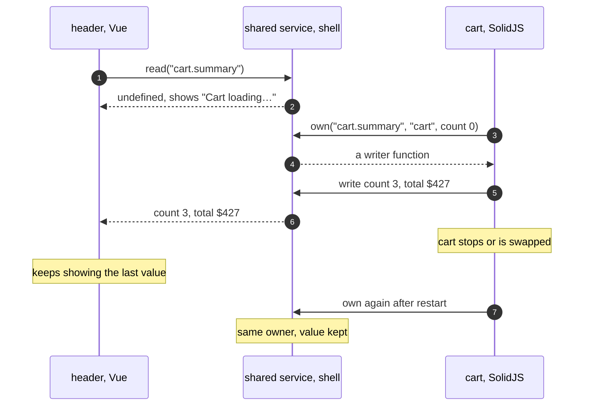

# 4. Shared state

Every piece of state in the showcase has exactly one writer. What differs is who may read it. There are three kinds:

| Kind | Example | Written by | Read by | Survives a reload | Survives a module restart |
| --- | --- | --- | --- | --- | --- |
| URL state | path `/audio`, `?product=`, `?q=` | the shell, when a module asks | any module | yes | yes |
| Owned shared value | `cart.summary` | its owning module only | any module | no, the owner rebuilds it | yes, the shell keeps it |
| Internal state | cart lines, toasts, product list | the micro frontend itself | nobody else | only if the team persists it | only if the team persists it |



## Why the URL is the main shared state

The things several modules care about are the selected category, the displayed product and the search text. All three are navigation, so they live in the URL:

- **A deep link restores every module.** Each one reads the URL when it starts, so nothing has to be replayed.
- **Back and forward work for free.** The shell turns them into store updates, and every module reacts as it would to a click.
- **No module waits for another.** The catalog does not need navigation to be running to know the category.

State that should not survive a shared link, such as a half-typed form or a toast, does not belong in the URL.

## The location service

The contract in `contracts/index.d.ts`:

```ts
export interface LocationService {
    readonly $path: ReadableAtom<string>;
    readonly $query: ReadableAtom<Readonly<Record<string, string>>>;
    navigate(path: string, options?: { query?: QueryPatch; replace?: boolean }): void;
    setQuery(patch: QueryPatch, options?: { replace?: boolean }): void;
}
```

The stores are read-only nanostores atoms. A module never calls `history.pushState` itself. It calls an action, and the shell writes history and updates the stores:



The calls used across the micro frontends:

```ts
// navigation, React: change category, keep the current query
location.navigate(path, { query: location.$query.get() });

// header, Vue: search text, replacing the history entry so typing does not add one per key
props.location.setQuery({ q: value || undefined }, { replace: true });

// catalog: select a product, merged into the current query
location.setQuery({ product: card.dataset.productId });
```

`setQuery` merges the patch into the current query. A key set to `undefined` is removed. The service only updates a store when its value really changed, so subscribers are not woken for nothing.

## Owned shared values

Some shared state is not navigation. The header's badge needs the cart's item count and total, but those belong to the cart. The `shared` service gives such a value exactly one owner:

```ts
export interface SharedStateService {
    own<K extends keyof SharedValues>(key: K, owner: string, initial: SharedValues[K]): (value: SharedValues[K]) => void;
    read<K extends keyof SharedValues>(key: K): ReadableAtom<SharedValues[K] | undefined>;
}
```



The rules the service enforces:

- **One owner per key.** A second module that tries to own `cart.summary` gets an error, so two teams cannot fight over a value.
- **Readers can start first.** `read` returns a store at once, holding `undefined` until the owner claims it. The header shows "Cart loading…" for that moment.
- **Restarts keep the value.** When the cart starts again, or a new version replaces it, claiming the key again keeps the current value until the cart writes a fresh one.

The cart derives the summary from its internal store and writes it whenever it changes:

```tsx
const setSummary = sandbox.getService("shared").own("cart.summary", sandbox.moduleId, { count: 0, total: 0 });
const unbindSummary = computed([store.$count, store.$total], (count, total) => ({ count, total })).subscribe(setSummary);
```

## Internal state

Everything else stays inside a micro frontend, and no other code can reach it:

| Micro frontend | Internal state | Where it is kept |
| --- | --- | --- |
| cart | the lines | memory, saved to the cart backend on every change |
| product-detail | the product list, the chosen quantity | memory; the list is fetched from its own API in `init` |
| recommendations | the product list | memory; fetched from the product API in `init` |
| header | the toast list | a private nanostores atom |
| catalog, navigation | none | everything they show comes from the URL |

Internal state is lost when a module stops, unless the team persists it. The cart persists its lines, which is why it comes back intact after a restart or a runtime swap. Chapter 5 explains how other modules can still change internal state: they ask with a message.

## Reading stores in six frameworks

nanostores atoms work everywhere because each framework has a small binding, and the binding only needs the store it is given:

| Micro frontend | Binding | Usage |
| --- | --- | --- |
| navigation, React | `@nanostores/react` | `useStore(location.$path)` |
| header, Vue | `@nanostores/vue` | `useStore(props.location.$query)` |
| product-detail, Svelte | none: atoms follow the Svelte store contract | `$query.product` in the template |
| recommendations, Angular | none: a five-line `fromStore` helper copies the atom into a signal | `this.query().product` in a `computed` |
| cart, SolidJS | `@nanostores/solid` | `useStore(props.cart.$lines)` |
| catalog and the shell's inspector, plain script | none | `location.$path.subscribe(render)`, released on abort |

Each micro frontend bundles its own copy of its binding. It still works with stores the shell created, because the binding only calls `get`, `listen` and `subscribe` on the store it receives.

## Rules of thumb

- **If a link should restore it, put it in the URL.**
- **If another module needs to show it, give it one owner and share it read-only.**
- **Otherwise keep it internal**, and persist it in the team's backend if it must survive restarts and swaps.
- **Never send state in messages.** A module that starts late would miss it. Chapter 5 shows what messages carry instead.
