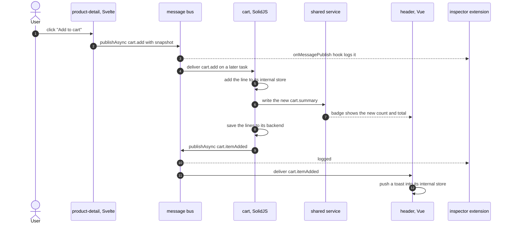

# 5. Messages

Shared state answers "what is true now?". Messages answer "please do this" and "this just happened". They travel over the justcore message bus, so the sender never knows which module, if any, handles them.

## Two kinds of message

| Kind | Meaning | Named | Example |
| --- | --- | --- | --- |
| Request | Asks the owner of some internal state to change it. The owner may refuse. | imperative: `cart.add` | the product page asks the cart to add a product |
| Fact | Announces a change that already happened. Any number of modules may react. | past tense: `cart.itemAdded` | the header shows a toast |

Only the owner of internal state changes it. A request is how another micro frontend influences that state without reaching into it.

## The message catalog

All messages are declared in `contracts/index.d.ts`:

| Type | Kind | Sent by | Handled by | Payload |
| --- | --- | --- | --- | --- |
| `cart.add` | request | product-detail, recommendations | cart | a product snapshot and a quantity |
| `cart.itemAdded` | fact | cart | header | product id, name and quantity |
| `order.placed` | fact | cart | header | item count and total |

```ts
export interface CartAddMessage extends jc.Message {
    type: "cart.add";
    product: CartProduct;   // id, name, price, color: a snapshot, not a reference
    quantity: number;
}

export type ShowcaseMessage = CartAddMessage | CartItemAddedMessage | OrderPlacedMessage;
```

The request carries a snapshot of the product. The cart can then show the line without calling the product team's API, and the two teams stay independent.

## Add to cart, end to end



The two halves of that flow use different channels on purpose:

- **The badge follows shared state**, so it is right even if the header starts after the item was added.
- **The toast follows a fact**, because it only makes sense at the moment it happens.

## How a module subscribes

A module lists the types it wants in `moduleWillSubscribe` and handles them in `moduleDidReceiveMessage`. The core does the wiring:

```tsx
// mfes/cart/src/index.tsx
moduleWillSubscribe: () => ["cart.add"],
moduleDidReceiveMessage(message: ShowcaseMessage) {
    if (message.type !== "cart.add" || !cart) {
        return;
    }
    cart.add(message.product, message.quantity);
    sandbox.publishAsync<CartItemAddedMessage>({
        type: "cart.itemAdded",
        productId: message.product.id,
        name: message.product.name,
        quantity: message.quantity
    });
}
```

- **Subscriptions start after `init` resolves.** A module never receives a message before it has rendered.
- **Subscriptions end when the signal aborts.** Stopping, failing or swapping a module unsubscribes it without code in `destroy`.
- **Narrowing works.** `ShowcaseMessage` is a union keyed on `type`, so TypeScript knows the payload after the `type` check.

## Delivery rules

| Rule | Consequence |
| --- | --- |
| Delivery is asynchronous, one task per handler. | `publishAsync` returns at once. The sender never runs inside a receiver's call stack. |
| The handler is looked up at delivery time. | A module that stopped after the publish does not receive the message. |
| A throwing handler is logged and isolated. | One broken receiver never blocks the others or the sender. |
| There is no replay and no queue. | A message with no subscriber at publish time is gone. |

The inspector's hint suggests trying the last rule. Stop the cart, then add a product. The `cart.add` request appears in the log, but nothing handles it and the cart does not change. Start the cart again: it reloads its lines from its backend, and the product added while it was stopped is not there.

That behavior is deliberate. Requests are commands for a module that is running now. A flow that must not lose a request needs a durable path, such as the product page calling the cart team's API, or the cart reading pending requests from its backend when it starts.

## Designing new messages

- **Prefix with the owning domain:** `cart.add`, not `addToCart`.
- **Requests are imperative and go to one owner. Facts are past tense and go to anyone.**
- **Carry snapshots and identifiers, never live objects or stores.**
- **Do not carry state that a late starter would need.** Put it in shared state instead.
- **Change messages additively.** Add optional fields. For a breaking change, introduce a new type, have the receiver handle both, move the senders, then remove the old type. Chapter 7 shows that sequence across deploys.
