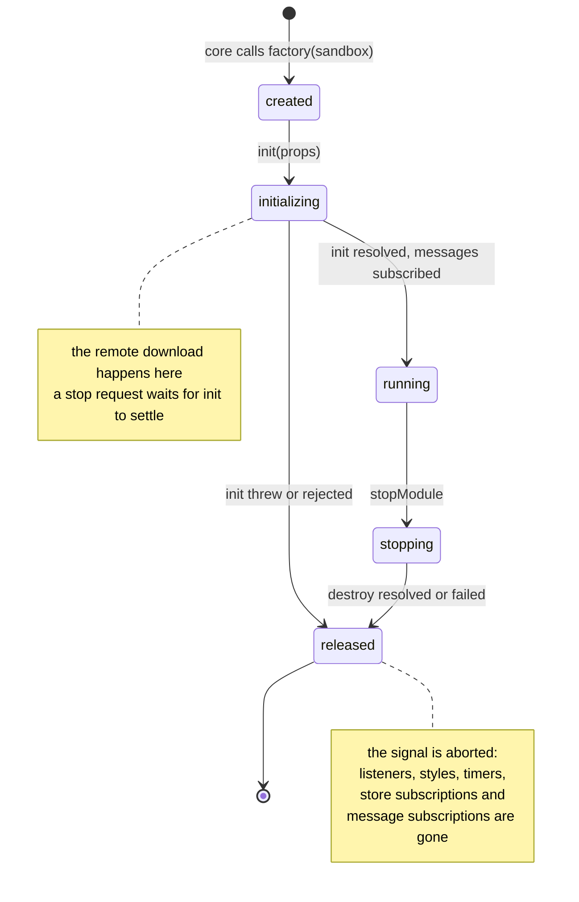
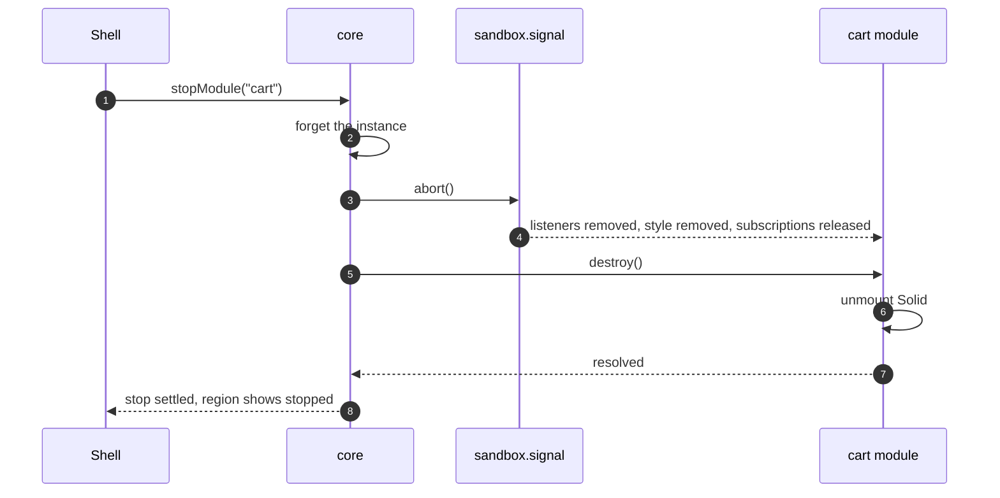

# 6. Module lifecycle

Starting, stopping and swapping micro frontends is only safe if each one cleans up completely. justcore 3 makes that the default: `init` and `destroy` may be asynchronous, and every sandbox has an `AbortSignal` that the core aborts when the module stops.

## The life of one module instance



What the core guarantees:

- **An instance counts as running only after `init` resolves.** The inspector's running column and `core.runningModules` reflect that.
- **A failed start cleans up, then reports.** The core removes the instance and aborts the signal; if `init` had finished and a later step failed, it calls `destroy` too. Then `startModule` rejects with the error.
- **A stop during `init` waits.** Stopping the product page while its products are still loading lets `init` settle, then stops the instance if it started.
- **A failing `destroy` cannot leave a half-stopped module.** The core removes the instance and aborts the signal before it calls `destroy`.
- **Starting twice is safe.** A start for an instance that exists returns the same pending start instead of creating a second instance.

The shell adds an error boundary on top: a module that crashes while running is stopped, not the page. The shell listens for uncaught errors, finds the module whose bundle threw by the bundle's URL in the stack, stops it through the core and shows the error in its region. The other modules keep running. `npm run build:faults` builds a product detail release that crashes this way.

## The signal is the cleanup list

Each micro frontend ties everything it creates outside its framework to `sandbox.signal`:

| Micro frontend | Tied to the signal |
| --- | --- |
| all | the `<style>` element from `adoptStyles` |
| catalog | the inserted markup, its click listener, both store subscriptions |
| cart | the summary subscription, the backend save subscription |
| header | each toast's timer |
| product-detail, recommendations | the product API request, which is aborted if the module stops while loading |

```ts
// mfes/*/src/dom.ts, copied into each micro frontend
export function adoptStyles(css: string, signal: AbortSignal): void {
    const style = document.createElement("style");
    style.textContent = css;
    document.head.append(style);
    signal.addEventListener("abort", () => style.remove(), { once: true });
}
```

`destroy` is then left with one job: unmount the framework.

| Framework | Mount in `init` | Unmount in `destroy` |
| --- | --- | --- |
| React | `createRoot(root).render(...)` | `root.unmount()` |
| Vue | `createApp(...).mount(root)` | `app.unmount()` |
| Svelte | `mount(Component, { target: root })` | `unmount(app)` |
| SolidJS | `render(() => ..., root)` | the dispose function `render` returned |
| Angular | `createApplication(...)`, then `app.bootstrap(Component, host)` | `app.destroy()`, then remove `host` |
| Astro markup | `root.innerHTML = fragment` | nothing: the signal clears the markup |

## Stopping a module, step by step



## Asynchronous `init`

The cart and the product page do real work before they render:

```ts
// mfes/product-detail/src/index.ts
async init(props) {
    const root = requireRoot(props);
    adoptStyles(css, sandbox.signal);
    const products = await fetchProducts(sandbox.signal);
    app = mount(ProductDetail, { target: root, props: { products, /* … */ } });
}
```

While `init` is pending, the region shows the shell's loading label. If the product API fails, the start fails like a failed download, and starting again retries.

## Restarting keeps shared state, not internal state

A restart creates a fresh instance with a fresh signal. What the new instance sees:

| State | After a restart |
| --- | --- |
| URL state | unchanged; the new instance reads it in `init` |
| `cart.summary` | unchanged until the cart writes a new value |
| Cart lines | reloaded from the cart backend |
| Toasts | empty |
| Messages sent while stopped | lost |

These are the same rules that make a runtime swap work, covered in chapter 8.
