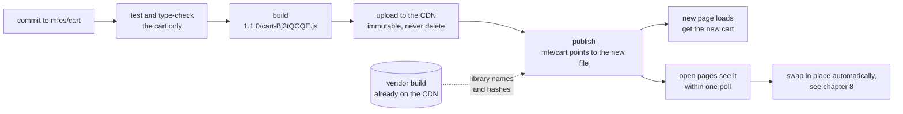
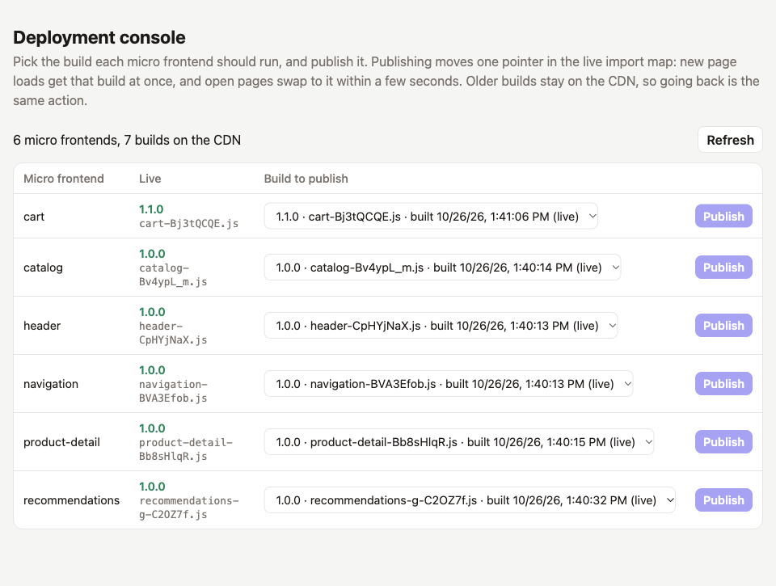
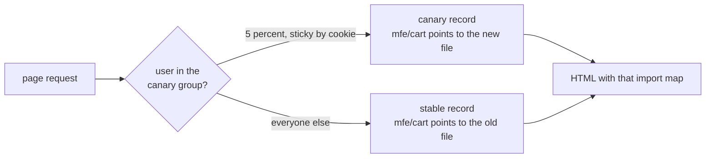
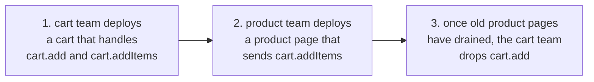

# 7. Deploying one micro frontend

A deploy in this architecture is two separate acts:

1. **Upload** a new, content-hashed bundle next to the old ones. Nothing changes for users yet.
2. **Publish** it by pointing one entry of the live import map at the new file, and adding any shared library versions the file imports. The next page load gets the new version, and open pages swap it in.

Because the files never change and the pointer is a single entry, one team can release, roll back or stage a release without rebuilding or even notifying anyone else.

## The pipeline of one team



What each step guarantees:

| Step | Guarantee |
| --- | --- |
| Verify | Runs only the cart's tests and checks, against the contract it compiles with. |
| Build | Produces one file whose name changes whenever its content does. Framework imports become versioned names, as chapter 10 explains. |
| Upload | Adds the file. Never overwrites or deletes, so open pages and rollbacks keep working. |
| Publish | Runs only after the upload succeeded. Computes the hash from the uploaded bytes. Refuses a bundle whose shared libraries are not on the CDN. Replaces the record in one atomic write. |

## Try it locally

With `npm start` running and the shop open in a browser:

```sh
# 1. change something visible, for example the heading in mfes/cart/src/Cart.tsx,
#    and raise "version" in mfes/cart/package.json (this example went from 1.0.0 to 1.1.0)

# 2. build only the cart; the new release appears next to the old one
npm run build --workspace mfes/cart
ls cdn/cart/*
# cdn/cart/1.0.0:
# cart-DqFGBwNj.js
#
# cdn/cart/1.1.0:
# cart-Bj3tQCQE.js

# 3. publish it
node scripts/publish.mjs cart
# cart: 1.0.0/cart-DqFGBwNj.js -> 1.1.0/cart-Bj3tQCQE.js
```

Within a few seconds the open page swaps in the new cart by itself. The cart's label changes from `cart 1.0.0` to `cart 1.1.0`, and the inspector logs `updated cart: 1.0.0 → 1.1.0`. A build that changes code without raising the version gets a new hash in the same folder, and the inspector then names the file instead of the version. With automatic updates switched off in the inspector, it offers an update button instead. No other micro frontend, no shared library and not the shell were rebuilt.

`scripts/publish.mjs` is the stand-in for a deployment service. It accepts several targets and an explicit file:

```sh
node scripts/publish.mjs cart                          # the file the last cart build produced
node scripts/publish.mjs cart=1.0.0/cart-DqFGBwNj.js   # any build still on the CDN
node scripts/publish.mjs header cart                   # several micro frontends at once
```

The publish logic lives in `scripts/deployments.mjs`, which the deployment console below uses too. It reads the build's manifest, checks that the file is on the CDN, and hashes it with SHA-384. It also reads the file's imports and adds the shared library names it needs, as chapter 10 explains. It then writes the new record to a temporary file and renames it over the old one, so a reader never sees half a file. Only the named entries change. The hash of the replaced version is dropped from the record:

```js
// scripts/importmap.mjs
export function publish(map, { id, url, integrity, libraries = { imports: {}, integrity: {} } }) {
    const previous = map.imports[specifierOf(id)];
    const imports = { ...map.imports, ...libraries.imports, [specifierOf(id)]: url };
    const hashes = { ...map.integrity, ...libraries.integrity, [url]: integrity };
    if (previous && previous !== url) {
        delete hashes[previous];
    }
    return { imports, integrity: hashes };
}
```

## Choosing a version in the deployment console

By default a team publishes the build it just made. The deployment console at http://localhost:4330 lets anyone choose instead: it lists every build of every micro frontend on the CDN, marks the live one, and publishes the selected one.



| Part | What it does |
| --- | --- |
| `GET /api/builds` | Lists `cdn/<id>/<version>/*.js` for every micro frontend, newest version first, and which file the live record names. |
| `POST /api/publish` with `{ targets: [{ id, file }] }` | Accepts only builds the listing offers, then calls the same `publishBuilds` as `publish.mjs`, with the same library and export checks. Several targets are written to the record in one step, so open pages pick up the whole release in the same check. |
| `console/index.html` | One select per micro frontend, labelled with version, file and build time, and a Publish button. |

Publishing from the console moves the same pointer as the command line, so open pages swap within one poll and new page loads get the selected build. Going back to an older release is the same action as going forward. Because the console offers only builds that exist and pass the checks, nobody can publish a URL that is not on the CDN. The console has no sign-in, so it listens on 127.0.0.1 only. A production console sits behind single sign-on, limits each team to its own micro frontends, and records who published what.

## Rolling back

A rollback is a publish of an older file. Nothing is rebuilt, and the old file is still on the CDN. Pick it in the console, or name it on the command line:

```sh
node scripts/publish.mjs cart=1.0.0/cart-DqFGBwNj.js
# cart: 1.1.0/cart-Bj3tQCQE.js -> 1.0.0/cart-DqFGBwNj.js
```

New page loads get the old version at once. Open pages see that their running version differs from the record, and swap back the same way they swapped forward.

## From the local stand-ins to production

| Locally | In production |
| --- | --- |
| `cdn/` served by `serve.mjs` on port 4400 | An object store such as S3, R2 or GCS behind a CDN |
| `cdn/vendor/`, built by the `vendor` package | The same object store, uploaded by the platform team's pipeline before any bundle that needs it |
| `deployments/importmap.json` | A small record in a database, a key-value store or a short-lived object, one per environment |
| `scripts/publish.mjs` | A deploy step in each team's CI, or a deployment API it calls |
| The deployment console on port 4330 | An internal release tool, such as an import map deployer with a UI, behind single sign-on |
| `serve.mjs` on port 4329 rendering the import map | The shell's server or an edge function, reading the record per request with a short cache |
| `CDN_URL`, `CDN_DIR`, `IMPORT_MAP` environment variables | The same settings per environment |

The record is small and read on every page load, so it should be cached at the edge for seconds, not minutes. The bundles it points to are cached for a year.

### A sketch of one team's workflow

This is an illustration, not a file in this repository. The bucket, the CDN host and the deploy API are placeholders:

```yaml
# .github/workflows/deploy-cart.yml
name: Deploy cart
on:
  push:
    branches: [master]
    paths: ["examples/showcase/mfes/cart/**", "examples/showcase/contracts/**"]

jobs:
  deploy:
    runs-on: ubuntu-latest
    environment: production
    permissions: { contents: read, id-token: write }
    env:
      BUCKET: ${{ vars.CDN_BUCKET }}
      DEPLOY_TOKEN: ${{ secrets.DEPLOY_TOKEN }}
    defaults:
      run:
        working-directory: examples/showcase
    steps:
      - uses: actions/checkout@v4
      - uses: actions/setup-node@v4
        with: { node-version: 24, cache: npm, cache-dependency-path: examples/showcase/package-lock.json }
      - run: npm ci
      - run: npm test --workspace mfes/cart && npm run check --workspace mfes/cart
      - run: npm run build --workspace mfes/cart
      - uses: aws-actions/configure-aws-credentials@v4
        with: { role-to-assume: "${{ vars.CDN_UPLOAD_ROLE }}", aws-region: eu-central-1 }

      # Upload: add the new file, never delete old ones.
      - run: >
          aws s3 cp cdn/cart s3://$BUCKET/cart --recursive --exclude ".vite/*"
          --cache-control "public, max-age=31536000, immutable"

      # Publish: move the pointer only after the upload succeeded.
      - run: |
          FILE=$(node -p 'Object.values(require("./cdn/cart/.vite/manifest.json")).find(c => c.isEntry).file')   # 1.1.0/cart-….js
          HASH="sha384-$(openssl dgst -sha384 -binary cdn/cart/$FILE | openssl base64 -A)"
          curl --fail -X PUT "https://deploy.example.com/importmap/production/cart" \
            -H "Authorization: Bearer $DEPLOY_TOKEN" \
            -d "{\"url\": \"https://cdn.example.com/cart/$FILE\", \"integrity\": \"$HASH\"}"
```

The deploy API does what `publish.mjs` does, including adding the shared library names the bundle imports and refusing it if their files are not on the CDN. It should also keep an audit log of who published what and when, which makes rollbacks a one-line lookup.

## Staged releases

Because the shell server picks the import map for each request, it can pick a different one for some users. A canary release needs no change in any micro frontend:



A sketch of the server side, not implemented here:

```js
const record = isInCanary(request) ? "importmap.canary.json" : "importmap.json";
const map = await readRecord(record);
const html = template.replace("__IMPORT_MAP__", () => escapeForScript(map));
```

Promoting the canary means publishing the same file to the stable record. Aborting it means publishing the old file to the canary record. The same mechanism gives per-tenant versions, preview links for a pull request, and a kill switch.

## Keeping old versions

Old bundles must stay on the CDN at least as long as:

- the longest session that might still be running them,
- any CDN or browser cache that might still serve an import map naming them,
- and the window in which a rollback to them is realistic.

A safe policy is to delete only files that no record has named for several weeks. The same applies to vendor files, counting every chunk that a named library file loads, as listed in `libraries.json`. Locally, `cdn/` simply grows. Every rebuild that changes code adds a file there.

## Changing the contract without a coordinated release

Teams deploy at different times, so the shell and the six micro frontends run in many version combinations. The contract in `contracts/index.d.ts` must therefore change in steps that each work with the versions already deployed.

**Additive changes are always safe.** Examples are a new optional field in a message, a new message type, or a new key in `SharedValues`.

**A breaking change takes three deploys**, in the expand and contract pattern. For example, `cart.add` could be replaced by a `cart.addItems` request that carries several products:



At no point does a running sender talk to a receiver that does not understand it. The same pattern applies to services the shell provides: the shell adds the new capability first, the micro frontends adopt it, and the old one is removed last.

## Deploying the shell

The shell is deployed on its own too. Its boot script is content-hashed by Astro, and its HTML is not cached. A shell deploy changes neither the record nor any bundle. Two kinds of change do need a shell deploy:

- **Adding a region or a micro frontend.** The shell owns the layout and the list of modules, as chapter 9 shows.
- **Changing a service.** Use the expand and contract steps above, so micro frontends built against the previous contract keep working.
