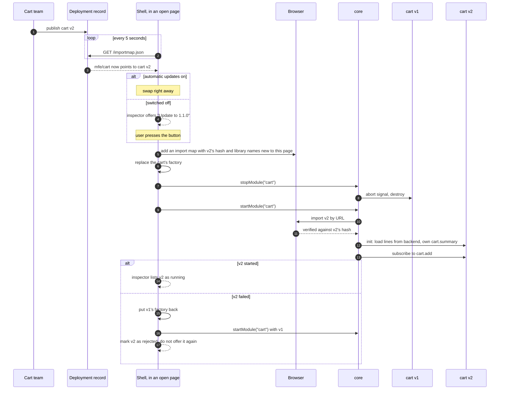
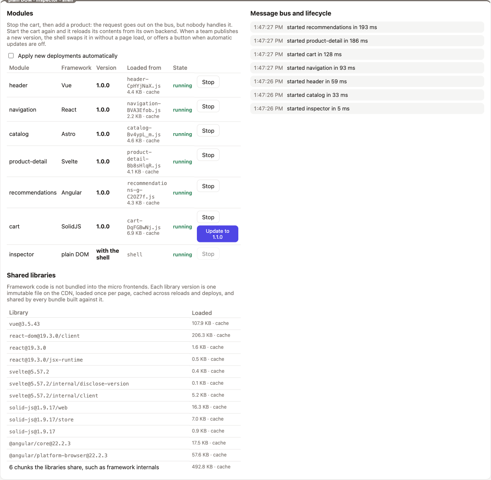
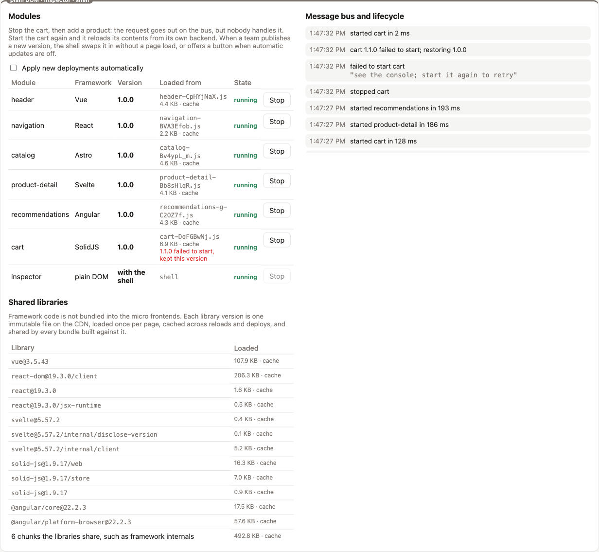

# 8. Runtime updates

Micro frontends can be swapped at runtime, and the showcase does it. When a team publishes a new version, every open page notices within a few seconds and swaps it in automatically. The swap replaces the running module with the new version in place, with no page load. A switch in the inspector turns automatic updates off, and the shell then offers a button instead.

There are two levels of update:

| Level | How | Always safe | Implemented here |
| --- | --- | --- | --- |
| Next page load | The shell server renders the new import map. | yes | yes |
| In place, while the page is open | The shell stops the module and starts the new version. | when the rules below hold | yes, automatically or behind a button |

## Why justcore can do this

Three properties combine:

1. **The core calls a module's factory on every start.** The shell registers a small indirection per module, so changing what stands behind it changes what the next start loads:

   ```ts
   // shell/src/app/shell.ts
   core.addModule(info.id, sandbox => factories.get(info.id)!(sandbox));
   ```

2. **`remoteModule` caches the download per factory.** A new factory for a new URL downloads the new file.
3. **Stopping a module removes everything it created.** The signal and `destroy` release its markup, styles, listeners and subscriptions, so the new version starts on a clean region.

## What happens during a swap



The essential code, from the shell service:

```ts
addMissingEntries(); // hashes and library names the page has not registered yet
const previous = factories.get(id)!;
factories.set(id, remote(url));
const wasRunning = isRunning(id);
if (wasRunning) {
    await shell.stop(id);
}
if (!wasRunning || await shell.start(id)) { // start resolves to whether the module started
    patch(id, { source: url, update: undefined });
    return;
}
factories.set(id, previous);
patch(id, { update: undefined, rejected: url });
await shell.start(id);
```

After a swap, the region's label reads `SolidJS · cart 1.1.0 · CDN` instead of `cart 1.0.0`, and the inspector's Version column changes with it. The shell takes the version from the folder in the bundle's URL and sets it on the region at every start, so a rollback shows up the same way.

With automatic updates switched off, the inspector offers the new version next to the running one:



If the new version fails to start, the old version comes back by itself, and the failed file is not offered again:



## What survives a swap

| State | After the swap | Why |
| --- | --- | --- |
| The URL: path, product, search | kept | The shell owns it. The new version reads it in `init`. |
| `cart.summary` and the header badge | kept | The shell keeps owned values. Claiming again with the same owner keeps the value. |
| Cart lines | kept | The cart saves them to its backend and reloads them in `init`. |
| Other modules | untouched | Only the cart's region is stopped and started. |
| In-memory internal state | lost | For example, an open dropdown or an unsaved form inside the swapped module. |
| Messages sent during the swap | lost | Between the old version's stop and the new version's subscription, nobody handles `cart.add`. |

## The rules that make a swap safe

A micro frontend is swap-safe when all of these hold:

- **Everything it creates is tied to the signal or undone in `destroy`.** A listener on `window` added at import time would outlive the swap and run twice.
- **Importing the bundle has no side effects.** The old file stays in the browser's module map until the page unloads, because ES modules cannot be unloaded. Code that only runs in `init` costs nothing after the swap. Code that ran at import time keeps running.
- **State that must survive is persisted or shared.** The cart persists its lines. A module with valuable in-memory state should not be swapped without warning.
- **The new version speaks the same contract.** Chapter 7's expand and contract steps make every published version compatible with the versions around it.

## Two browser limits

**A name cannot be remapped after it was used.** Once the page has imported `mfe/cart`, a later import map entry for `mfe/cart` is ignored, and the name keeps resolving to the old URL. The shell therefore imports the new version by its full URL.

The same limit is why shared library names carry their version. A new version that needs Solid 1.9.18 imports `solid-js@1.9.18/web`, a name the page has never seen, so the shell can add it next to `solid-js@1.9.17/web`. A new version on the same library version imports names the page already loaded, and downloads nothing more. Chapter 10 shows both cases.

**Integrity for that URL needs a second import map.** The page's first import map has no hash for the new file. The shell adds an import map that holds just that hash before it imports the file. Browsers that merge import maps added later then enforce it. In Chromium 156, a wrong hash in such a map made the import fail.

| Browser | Integrity in import maps | Import maps added later |
| --- | --- | --- |
| Chrome and Edge | 127 | 133 |
| Safari | 18 | 18.4 |
| Firefox | 138 | 150, behind the `dom.multiple_import_maps.enabled` preference |

Source: MDN browser compatibility data for `<script type="importmap">`.

A browser without that merging would ignore the added hash and load the file unchecked. The shell refuses that. On the first update it checks whether an added import map takes effect, by resolving a probe name through `import.meta.resolve`. Where it does not, the update reloads the page instead, and the server renders the new version with its hash.

## Choosing an update policy

The showcase swaps immediately, so a deploy is visible within seconds. The inspector's switch changes that to a button. In browsers that cannot add import maps, automatic swaps are skipped, because there an update means a page reload. Production shells choose by risk:

| Policy | When to use it |
| --- | --- |
| Swap immediately | What the showcase does. Fine for swap-safe modules whose state is persisted or shared. |
| On the next page load only | The default. Always safe, needs nothing from the micro frontend. |
| Swap while the tab is hidden | Good for swap-safe modules. Listen for `visibilitychange` and update when the page is not visible. |
| Swap on the next route change | When a module's region is about to re-render anyway. |
| Prompt the user | When the module holds in-memory work the user might lose. |
| Force immediately | Security fixes. Accept losing in-memory state. |

Whatever the policy, the shell should report rejected versions to the team's monitoring. A rejected version is still the published one, so new page loads keep getting it until someone rolls back.

## Production notes

- **Poll less, or push.** The showcase polls every five seconds to keep the demonstration quick. A production shell would poll every few minutes with an ETag, or receive a server-sent event when a record changes.
- **Protect the swap gap if requests must not be lost.** Options are a justcore extension that holds messages for a module while it restarts, a retry in the sender, or a durable request through the owning team's API.
- **Update one module at a time.** Each swap is independent. The rollback logic only has to restore one factory.
