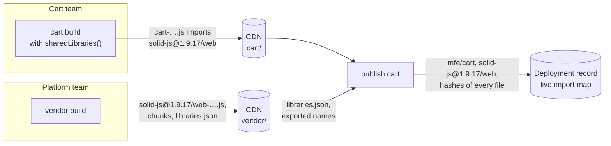
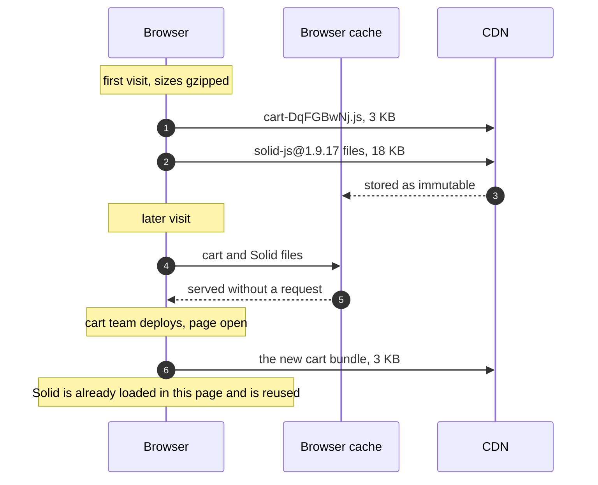

# 10. Shared framework libraries

The micro frontends don't bundle their frameworks. The platform team builds React, Vue, Svelte, SolidJS and Angular once, puts them on the CDN as immutable files, and pages load them through the import map. A deploy then ships only a team's own code, a few kilobytes, and the framework comes from the browser's cache.

This chapter explains how that works without making teams upgrade together, what it costs, and how a team moves to another framework version while pages are open.

## The parts

| Part | Owned by | What it does |
| --- | --- | --- |
| `vendor/libraries.mjs` | platform team | The list of shared packages and their entry points, for example `solid-js`, `solid-js/web` and `solid-js/store`. |
| `vendor/vite.config.mjs` | platform team | Builds every listed entry point of every installed version into `cdn/vendor/`, and records them in `cdn/vendor/libraries.json`. |
| `vendor/plugin.mjs` | platform team, used by every team | A Vite plugin that leaves shared packages out of a bundle and rewrites their imports to versioned names. |
| `scripts/deployments.mjs` | the deployment service, behind `publish.mjs` and the deployment console | Adds the library names a bundle imports to the import map, with hashes. Refuses the bundle if the CDN lacks a library or a name it imports. |



## Versioned names

The plugin rewrites each framework import to a name that carries the version the micro frontend installed:

```js
// in mfes/cart/src, as written
import { render } from "solid-js/web";

// in cdn/cart/1.0.0/cart-DqFGBwNj.js, as built
import { render as i } from "solid-js@1.9.17/web";
```

The import map points that name at the vendor build:

```json
"solid-js@1.9.17/web": "http://localhost:4400/vendor/solid-js@1.9.17/web-RYK6nA_w.js"
```

One plain `solid-js` name for everyone would be simpler, but it would break three things:

- **Compiled code belongs to one runtime version.** Svelte, Solid and Angular compile templates into calls to their runtime's internals. A bundle compiled for one version may not run on another, as the upgrade test below shows.
- **Teams would have to upgrade together.** With one name, a page can hold only one version.
- **Runtime swaps could not change the version.** Once a page has resolved a name, a later import map cannot remap it, as chapter 8 explains. A new version under a new name is simply added next to the old one.

Two bundles built against the same version import the same name, so the browser loads and runs that library once. Two versions in one page are two copies, each matching what its bundles were compiled against.

The plugin reads the version from the micro frontend's own installation, even for imports that come from its dependencies, such as `@nanostores/solid`. So a bundle never asks for two versions of one library:

```js
// vendor/plugin.mjs
resolveId(source) {
    const library = libraryOf(source);
    if (!library) {
        return null;
    }
    if (!libraries[library.name].entries.includes(library.entry)) {
        this.error(`${source} is not provided by the vendor build; add "${library.entry}" to vendor/libraries.mjs`);
    }
    const { version } = packageJson(library.name, root);
    return { id: specifierOf(library.name, version, library.entry), external: true };
}
```

Each micro frontend's Vite config adds it before its framework plugin:

```ts
// mfes/cart/vite.config.ts
import { sharedLibraries } from "@showcase/vendor/plugin";

plugins: [sharedLibraries(), solid()],
```

## The vendor build

`vendor/vite.config.mjs` generates one entry module per entry point of every installed version, builds them all together, and records the result. Five details matter:

- **CommonJS packages.** React and React DOM ship CommonJS, so `export *` cannot see their exports. The build requires each one in Node, lists its export names, and writes an ES module wrapper that re-exports them.
- **Vue's feature flags.** The build uses Vue's browser build, which has its flags baked in, so bundles need no `__VUE_OPTIONS_API__` defines.
- **Angular's linker.** Angular publishes partially compiled packages. The build runs Angular's linker over them, as the Angular CLI does, so pages never need the 1 MB template compiler.
- **Production flags.** The build sets `ngDevMode` and Angular's other flags to `false`, as the Angular CLI does. Without them, Angular ran its development checks in the browser. That made the shared Angular about 30 percent larger, and it printed a warning when a second build of the recommendations component registered.
- **Shared internals.** All entry points are built together, so `solid-js/web` and `solid-js/store` import the same `solid-js` chunk. One version has one runtime instance per page.

### Every file is named by its content

After the bundler has written its files, the vendor build renames each one after a hash of its final bytes. It starts with the files that import nothing, and rewrites each import path to the new name before hashing the importing file:

```text
solid-js@1.9.17/web-RYK6nA_w.js   imports ../chunks/solid-jcsmHATi.js
chunks/solid-jcsmHATi.js
```

Rolldown's own `[hash]` was not enough. It does not cover the names of the chunks a file imports. In a test with a second Solid version, two different files both came out as `web-DYYN9VQq.js`, each importing a different chunk. A later build could then have reused a URL for different bytes, which breaks every cache that stored the old file as immutable and every integrity hash that names it.

Naming by final content has three effects:

- **A URL never changes meaning.**
- **A rebuild changes only what changed.** Files that are byte-for-byte the same keep their URLs, and stay in browsers' caches, across vendor builds.
- **Identical files are shared.** Solid 1.9.16 and 1.9.17 turned out to have byte-identical browser builds, so their names led to the same core chunk, and the page loaded it once.

`libraries.json` keeps the records of earlier builds, because published bundles may still import their files.

## Publishing a bundle that imports libraries

The publish step parses the bundle with `es-module-lexer`. For each library name the bundle imports, it looks the name up in `libraries.json` and checks the names the bundle takes from it against that file's exports. It then adds the import map entry and a hash for every file the library loads:

```js
// scripts/deployments.mjs
for (const [name, taken] of Object.entries(importedNames(parse(source)[0], source))) {
    const library = vendor[name];
    if (!library) {
        throw new Error(`${label} imports ${name}, which the vendor build has not put on the CDN`);
    }
    const exported = exportedNames(parse(readFileSync(join(cdnDir, "vendor", library.file), "utf8"))[1]);
    const missing = exported ? [...taken].filter(each => !exported.has(each)) : [];
    if (missing.length) {
        throw new Error(`${label} imports ${missing.join(", ")} from ${name}, which that version does not export`);
    }
    libraries.imports[name] = `${cdnUrl}/vendor/${library.file}`;
    for (const file of library.files) {
        libraries.integrity[`${cdnUrl}/vendor/${file}`] = hashOf(join(cdnDir, "vendor", file));
    }
}
```

Five rules follow from this code:

- **The vendor build deploys first.** A bundle whose libraries are not on the CDN is refused, so a publish never points pages at a missing file.
- **A bundle must fit its library version.** A bundle that imports a name its version does not export is refused. Without this check it would fail in every browser.
- **Every file is hashed**, including the chunks a library imports by relative URL, which no name in the map points at.
- **A name follows the latest vendor build of its version.** Files are named by content, so this moves only the files that changed. Open pages keep what they already resolved, which is compatible because the version is the same.
- **Library names are never removed.** A rollback may need them again. A real record would prune names that no published bundle imports, as a `shortcut:` comment in `scripts/importmap.mjs` notes.

## What gets downloaded, and when



The inspector shows this for every bundle and library: the file size, and whether it came from the network or the cache. A last row adds up the chunks the libraries share, which hold most of the framework code. The local CDN sends `Timing-Allow-Origin`, so the page can read those numbers for files from another origin.

In a test, a new cart version was published while the page was open. The page fetched only the new cart bundle, 7 KB before compression, and swapped it in about a second later. The Solid files it imports were already loaded.

## What it costs

A shared library keeps every export, because the vendor build cannot know which ones the bundles will use. A bundled framework keeps only the exports its bundle uses. The first visit therefore downloads more:

| Framework | Shared, gzipped | Bundled into its one micro frontend, gzipped |
| --- | --- | --- |
| Angular: core, common, platform-browser | 153 KB | 39 KB |
| React and React DOM | 68 KB | 69 KB |
| Vue | 41 KB | 23 KB |
| Svelte | 34 KB | 14 KB |
| SolidJS | 18 KB | 9 KB |
| All six micro frontends, first visit | 325 KB | 156 KB |

In this showcase each framework has a single user, which is the worst case. Sharing pays off when:

- **Several micro frontends use the same framework.** Each additional micro frontend then costs a few kilobytes instead of another copy of the framework.
- **Teams deploy often.** Returning visitors download a few kilobytes per deploy instead of the framework again.
- **The library is large and hard to tree-shake anyway.** React is the clearest case: it costs the same either way.

Sharing is decided per package. Remove a package from `vendor/libraries.mjs` and the plugin leaves it bundled. With one Angular micro frontend, bundling Angular would be the better choice in production. Here it is shared to show that the mechanism works for every framework.

## Upgrading a framework

A team can move to another framework version on its own. The steps below were run against an open page, with the cart moving from Solid 1.9.17 to 1.9.14. An older version was used because 1.9.17 was the newest 1.x release. The direction doesn't matter.

1. **The platform team adds the version to the vendor build.** An npm alias installs it next to the current one:

   ```json
   // vendor/package.json
   "solid-js": "1.9.17",
   "solid-js-1.9.14": "npm:solid-js@1.9.14"
   ```

   ```sh
   npm install && npm run build --workspace vendor
   ```

   Inside the aliased copy, an import of `solid-js` must mean that same copy, not the version installed under the plain name. The vendor build's alias resolver ensures this: `solid-js@1.9.14/web` imported its own core chunk. The resolver applies the same rule to sibling packages released under one version number, such as the `@angular/*` packages. Only the Solid case was tested.

2. **The cart team pins the new version and builds.**

   ```sh
   # mfes/cart/package.json: "solid-js": "1.9.14"
   npm install && npm run build --workspace mfes/cart
   # the bundle now imports solid-js@1.9.14, solid-js@1.9.14/web and solid-js@1.9.14/store
   ```

3. **The cart is published.** The import map gains the three 1.9.14 names, and the 1.9.17 names stay.

   ```sh
   node scripts/publish.mjs cart
   ```

4. **Open pages swap automatically.** The shell adds the new names and hashes in an added import map, then swaps the cart. The page fetched the new cart bundle, the three Solid 1.9.14 entry files and their core chunk. Solid 1.9.17 stayed in memory until the next page load. The cart, the header badge and the message flow kept working.

Rolling back is the same as for any deploy: publish the previous cart file. The 1.9.17 names are still in the map.

### When the compiler and the runtime disagree

The first attempt used Solid 1.9.5, and it failed. Solid's compiler is a separate package, and the current one emits calls to `setStyleProperty`, which the 1.9.5 runtime doesn't export. In the open page, the browser refused to link the new cart. The shell put the previous version back and marked the new file as rejected, as chapter 8 describes. New page loads would have failed the same way.

That attempt led to the export check in the publish step. The same bundle is now refused before any page sees it:

```text
Error: cart/cart-KaR7VEMG.js imports setStyleProperty from solid-js@1.9.5/web, which that version does not export
```

A version change therefore needs the matching compiler too: `vite-plugin-solid` for Solid, `@sveltejs/vite-plugin-svelte` for Svelte, and the Angular compiler for Angular. The check catches missing names, but not changed behaviour behind a name that still exists.

## Rules of thumb

- **Pin exact versions.** Different versions are different copies, unless their files happen to be identical. Automated dependency updates keep teams on the same versions, so in practice they share.
- **Upgrade the compiler with the runtime.** A team that changes its framework version changes its framework's build plugin in the same commit.
- **Share frameworks, not team code.** A shared library is third-party code at a pinned version. Helpers such as `formatPrice` are still copied into each micro frontend, because shared team code would force releases together.
- **Small bindings stay bundled.** `@nanostores/react` and the other bindings are tiny. They import their framework through the versioned name, like the rest of the bundle.
- **Know what one copy per version implies.** Bundles on the same version share that library's module state. Each micro frontend mounts its own root, so this is harmless here. A library with global configuration would be configured once for all of them.
- **New entry points need a vendor build first.** The plugin fails a micro frontend's build if it imports an entry point the vendor build does not list. A team that wants `svelte/motion` asks the platform team to add it.
