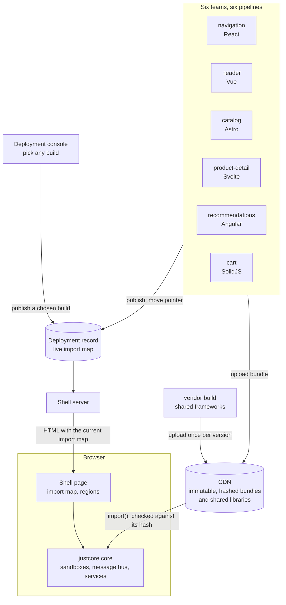

# Showcase documentation

The showcase is a small shop built from six micro frontends. Each one is written in a different framework, built and tested on its own, and deployed to a CDN as a single small file. The frameworks themselves are built once, shared through the import map, and cached by the browser. A thin shell page fetches them at runtime and runs them as modules of one [justcore](../../../README.md) core.

These pages follow one request from the moment the shell server answers it, through loading, shared state and messages, to deploying and swapping a single micro frontend in production.



## Chapters

| Chapter | What it answers |
| --- | --- |
| [1. Architecture](01-architecture.md) | What the parts are, who owns each one, and which rules keep them independent. |
| [2. The shell](02-shell.md) | What happens from the HTTP request to seven running modules. |
| [3. Loading remote micro frontends](03-loading-remotes.md) | What a deployable micro frontend is, and how the import map and `remoteModule` turn a URL into a running module. |
| [4. Shared state](04-shared-state.md) | How the URL and owned values are shared, and what stays private to each micro frontend. |
| [5. Messages](05-messages.md) | How modules ask each other for changes and announce facts over the message bus. |
| [6. Module lifecycle](06-lifecycle.md) | How modules start, stop, fail and clean up, in every framework. |
| [7. Deploying one micro frontend](07-deploying.md) | How one team ships, rolls back and stages a release without touching anyone else, from the command line or the deployment console. |
| [8. Runtime updates](08-runtime-updates.md) | How a new version replaces a running one without a page load, and where that stops being safe. |
| [9. Adding a micro frontend](09-new-micro-frontend.md) | How the Angular recommendations micro frontend was added, step by step. |
| [10. Shared framework libraries](10-shared-libraries.md) | How frameworks are loaded once from the CDN instead of bundled, at the version each bundle needs, and what that costs. |

Readers in a hurry can read chapters 1, 7, 8 and 10.

## Run it

```sh
# in the repository root: the shell installs justcore from here
npm ci && npm run build

# in examples/showcase
npm ci
npm run build    # builds the shared libraries and every micro frontend, publishes each one, builds the shell
npm start        # CDN and product API on :4400, shell on http://localhost:4329, deployment console on http://localhost:4330
```

## Words used in these pages

| Term | Meaning here |
| --- | --- |
| Shell | The page that owns the layout, the URL and the core. It is the only part that is not a micro frontend. |
| Micro frontend, or remote | An independently built and deployed part of the page. At runtime it is one justcore module. |
| Module | A justcore unit with `init` and `destroy`, created by a factory that receives a sandbox. |
| Sandbox | The object each module gets from the core. It is the module's only way to reach services and the message bus. |
| Bundle | The single JavaScript file a micro frontend build produces, such as `cart/1.0.0/cart-DqFGBwNj.js`. Its folder is the release version from `package.json`, and its name contains a hash of its content. |
| Deployment console | The small page on port 4330 that lists every build on the CDN and publishes the one you select. |
| Shared library | A framework package built once into `cdn/vendor/` and loaded through a versioned import map name, such as `solid-js@1.9.17/web`. |
| Import map | JSON in the page that tells the browser where `mfe/cart` lives and what hash its file must have. |
| Deployment record | The live import map, `deployments/importmap.json` locally. Publishing a version means changing one entry in it. |
| Contract | The types-only package `contracts` that every micro frontend and the shell compile against. |
| Shared state | State other modules depend on: the URL, and values with a single owner such as the cart summary. |
| Internal state | State only one micro frontend sees, such as the cart's lines or the header's toasts. |
| Request | A message asking the receiver to change its internal state, such as `cart.add`. |
| Fact | A message announcing something that already happened, such as `cart.itemAdded`. |
